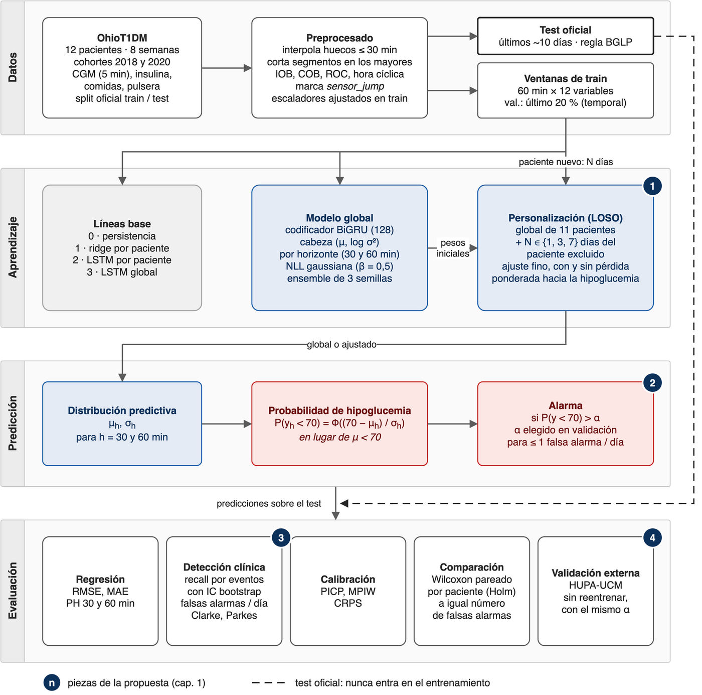
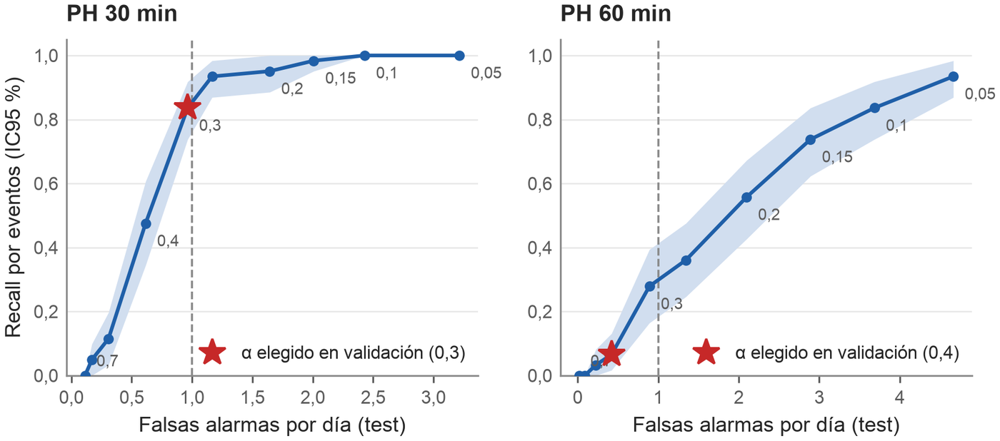
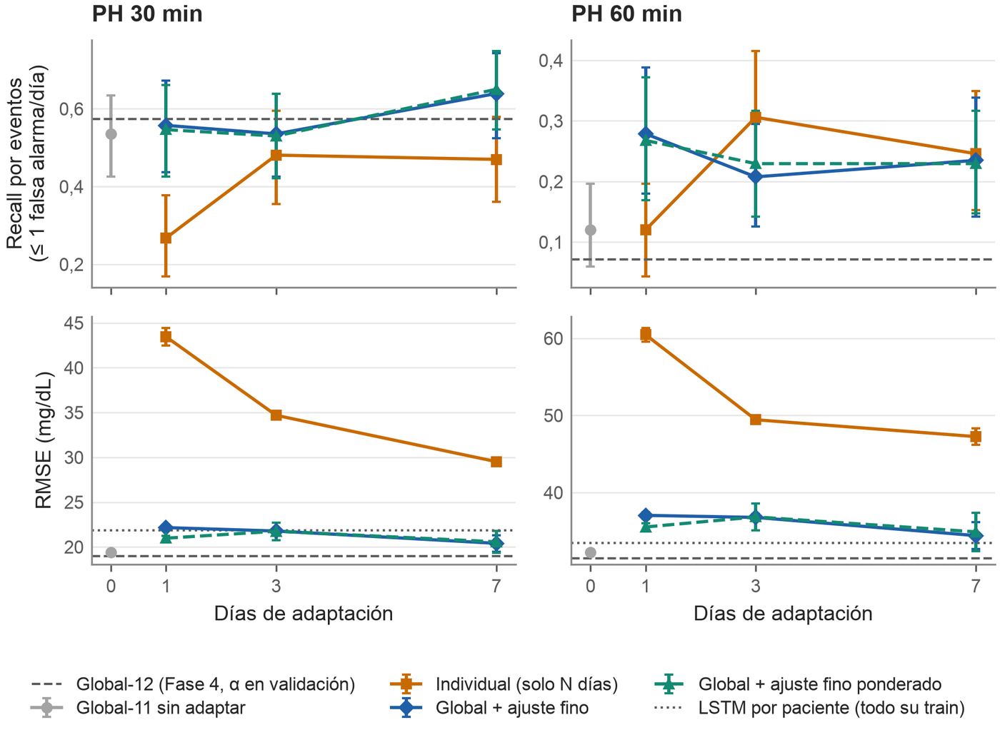

<!-- final -->
<p align="center">
  <picture>
    <source media="(prefers-color-scheme: dark)" srcset="docs/img/logo-uax-oscuro.png">
    
  </picture>
</p>
<!-- /final -->

# Predicción personalizada de glucosa e hipoglucemias en diabetes tipo 1 (OhioT1DM)

Código del Trabajo Fin de Máster de Miguel García Bilbao. Predice la glucosa intersticial (CGM)
a 30 y 60 minutos sobre el dataset OhioT1DM con un modelo global probabilístico (media y
varianza de cada horizonte) y evalúa la detección temprana de hipoglucemias con una
alarma `P(y < 70 mg/dL) > α`, además de las métricas de regresión.

<!-- final -->
<p align="center">
  
  
  
  
</p>

<p align="center"><sub>Trabajo Fin de Máster · Máster Universitario en Inteligencia Artificial ·
Universidad Alfonso X el Sabio · 2026</sub></p>

## De un vistazo

<p align="center">
  
</p>

El modelo final es un ensemble de tres semillas de un BiGRU global con salida gaussiana
(μ, log σ²) para cada horizonte. La alarma salta cuando `P(y < 70 mg/dL) > α`, con α elegido en
validación para no pasar de una falsa alarma al día. Cifras sobre el test oficial de los 12
pacientes, con 61 eventos de hipoglucemia puntuables:

| | PH 30 min | PH 60 min |
|---|---|---|
| RMSE del modelo final (mg/dL) | **18,84** | **31,29** |
| RMSE de la persistencia (mg/dL) | 23,50 | 38,55 |
| Recall por eventos de la alarma (IC95 %) | **0,836** (0,738–0,918) | 0,066 (0,016–0,131) |
| Falsas alarmas por día | 0,96 | 0,42 |
| Anticipación mediana | 25 min | 62,5 min (4 eventos) |
| Clarke, zonas A+B | 98,9 % | 96,8 % |

Qué aporta:

- **Evaluación por eventos**: recall con IC bootstrap sobre los eventos, falsas alarmas por día,
  Wilcoxon pareado por paciente con corrección de Holm y comparación con el BGLP con su
  agregación oficial.
- **Alarma probabilística** `P(y < 70) > α` en lugar de `μ < 70`. El punto de operación es muy
  sensible a α, porque cae en la zona empinada de la curva.
- **Paciente nuevo con 1, 3 y 7 días de datos** (*leave-one-subject-out*): con tan pocos días, el
  global sin ajustar es el mejor punto de partida, también a igual número de falsas alarmas.
- **Validación externa sin reentrenar** en HUPA-UCM con el mismo α: recall 0,845 (0,793–0,897)
  con 1,03 falsas alarmas al día a 30 min (13 pacientes, 174 eventos).

<p align="center">
  
  <br>
  <sub>Recall por eventos frente a falsas alarmas por día al variar α (banda: IC95 %). La estrella
  es el α elegido en validación; a 30 min queda junto a una falsa alarma al día.</sub>
</p>

<p align="center">
  
  <br>
  <sub>Paciente nuevo con 1, 3 y 7 días: recall con ≤ 1 falsa alarma al día (arriba) y RMSE (abajo).
  Los ajustes finos no se separan del global (los intervalos se solapan) y el modelo entrenado solo
  con el paciente es el peor en RMSE.</sub>
</p>
<!-- /final -->

## Requisitos e instalación

Python 3.11 o superior (desarrollado con 3.13).

```bash
python3 -m venv .venv
source .venv/bin/activate
pip install -r requirements.txt
pip install -e .
```

## Datos

OhioT1DM **no se incluye**: se distribuye bajo un *Data Use Agreement* (DUA) firmado entre
instituciones con sus autores (Marling y Bunescu, Ohio University). Con el acceso concedido,
los XML se colocan así:

```
datasets/OhioT1DM/{2018,2020}/{train,test}/<id>-ws-{training,testing}.xml
```

Después se generan los derivados:

```bash
python -m tfm.data.build            # XML -> data/interim/ (parquet por paciente y split)
python -m tfm.data.build_processed  # -> data/processed/ (ventanas .npz)
```

### Validación externa: HUPA-UCM

HUPA-UCM (Hidalgo et al., 2024) tampoco se incluye. Se descarga de Mendeley Data
(doi:10.17632/3hbcscwz44.1, licencia CC BY-NC-ND 4.0) y la carpeta descomprimida se coloca así:

```
datasets/external/HUPA-UCM/{Preprocessed,Raw_Data}/
```

```bash
python -m tfm.data.hupa             # Libre crudo + tratamiento -> data/external/hupa/
```

La glucosa se lee de las exportaciones crudas del FreeStyle Libre y no de `Preprocessed/`, que
interpola todos los huecos. Las decisiones de armonización (unidades, pacientes excluidos,
registro del tratamiento) están documentadas en `src/tfm/data/hupa.py`.

## Experimentos

Cada experimento es una configuración YAML en `experiments/configs/`, con sus semillas, y todos
se ejecutan con el mismo comando:

```bash
python -m tfm.training.run --config experiments/configs/<exp_id>.yaml
```

Escribe `metrics.json`, `train_log.csv` y las predicciones en `experiments/results/<exp_id>/`.
El repositorio incluye las métricas de los experimentos ya ejecutados; los pesos y las
predicciones no se versionan (derivan de datos sujetos al DUA). Para regenerarlos hay que seguir
este orden, porque unos experimentos leen los pesos o las predicciones de otros:

1. **Líneas base**, independientes entre sí: `20260915-baseline-persistencia`,
   `20260916-baseline-ridge`, `20260916-baseline-lstm-paciente` y `20260916-baseline-lstm-global`.
2. **Modelo global** `20260916-global-bigru`, cuyos pesos usan los pasos 3 y 5. Las ablaciones
   (`-transformer`, `-mse`, `-univariante`, `-historia24`) son independientes; la de historia
   necesita antes sus ventanas de 120 min:
   ```bash
   python -m tfm.data.build_processed --history 24 --out-dir data/processed_h24
   ```
   El barrido de hiperparámetros `20261019-global-bigru-barrido` (12 configuraciones × 3
   semillas, solo validación; registrado a posteriori) también es independiente y no lo lee
   ningún otro experimento.
3. **Umbral en validación y ensemble**: `20260928-global-bigru-alpha-val` y
   `20260930-global-bigru-ensemble`. Después, `20261019-global-bigru-ensemble-precision` puntúa
   las predicciones guardadas del ensemble para añadir la precisión y el F1 de su alarma.
4. **Personalización LOSO**: `20260928-loso-backbones` (un modelo global por paciente excluido y
   semilla), después `20260928-loso-{global,individual,ft,ft-ponderada}` y, al final,
   `20260930-loso-ft-rmse` y `20260930-loso-ft-ponderada-rmse`, que reseleccionan sobre ellos.
5. **HUPA-UCM**: sin reentrenar, `20261002-hupa-zeroshot` y sus variantes `-imputados` y
   `-escalador` (necesitan los pasos 2 y 3); con adaptación,
   `20261002-hupa-{global,individual,ft,ft-ponderada,ft-rmse,ft-ponderada-rmse}` (pasos 2 y 4).

**Tiempos.** El trabajo se desarrolló en un portátil Apple M1 Pro (16 GB) con aceleración MPS; no
hace falta GPU, y `pick_device` usa MPS, CUDA o CPU según lo que haya. Como orientación, los datos
se construyen en menos de un minuto, cada semilla del BiGRU tarda unos minutos, el barrido de
hiperparámetros casi dos horas y los modelos de `20260928-loso-backbones`, en torno a una hora. Las adaptaciones LOSO corren en CPU
(`device: cpu` en su configuración, porque ahí son deterministas) y tardan de una a varias horas
cada régimen.

**Reproducibilidad.** Las líneas base deterministas (persistencia y ridge) reproducen su
`metrics.json` exactamente. El entrenamiento de las redes en MPS o CUDA no es determinista bit a
bit: al reentrenarlas, las cifras cambian dentro de la variación entre semillas, y por eso cada
resultado se da con tres. Lo más sensible es el recall de la alarma, porque el umbral α cae en una
zona empinada de la curva de operación.

## Notebooks

```bash
jupyter lab
```

| Notebook | Contenido |
|---|---|
| `01_eda.ipynb` | Caracterización de los 12 pacientes, calidad de señal y perfil circadiano |
| `02_preprocesado.ipynb` | Features fisiológicas (IOB, COB), ventanas y comprobaciones de no fuga |
| `03_baselines.ipynb` | Líneas base: persistencia, ridge, LSTM por paciente y LSTM global |
| `04_modelo_global.ipynb` | Modelo global probabilístico, alarma `P(y<70) > α` y ablaciones |
| `05_personalizacion.ipynb` | Personalización LOSO: rendimiento frente a días de adaptación, cuatro regímenes y Wilcoxon |
| `06_resultados.ipynb` | Resultados finales: tabla maestra, ensemble de semillas, comparación con el BGLP 2020, anticipación, noche/día y episodios |
| `07_datos_externos.ipynb` | HUPA-UCM frente a OhioT1DM: por qué la glucosa se lee del Libre crudo, desplazamiento de las entradas y presupuesto de eventos |
| `08_validacion_externa.ipynb` | Validación externa sin reentrenar: error, alarma con el α de Ohio y sensibilidad a la armonización |
| `09_adaptacion_externa.ipynb` | Adaptación a pacientes de HUPA-UCM con 1, 3 y 7 días, también a igual número de falsas alarmas |

Los notebooks importan de `src/tfm/` y se guardan ejecutados. Las figuras se exportan a
`memoria/figuras/`, que se crea al ejecutarlos. Los notebooks 01, 02 y 07 solo necesitan los datos;
el resto lee los resultados de `experiments/results/`, predicciones incluidas, así que antes hay que
ejecutar sus experimentos.

## Tests

```bash
pytest
```

Sin los datos del DUA, los tests que leen ficheros del dataset se saltan.

## Estructura

```
src/tfm/
├── data/      parser XML, calidad de señal, features, ventanas, datasets de PyTorch
├── models/    líneas base, BiGRU, Transformer, cabezas probabilísticas
├── training/  bucles de entrenamiento, pérdidas, ejecución por configuración
├── eval/      métricas clínicas, protocolo de eventos, calibración, alarma
└── viz/       figuras
```

## Licencia

El código se distribuye con licencia MIT (`LICENSE`). La licencia no cubre los datos, que no se
incluyen: OhioT1DM está sujeto a su DUA y HUPA-UCM a la licencia CC BY-NC-ND 4.0. Tampoco cubre el
logo de la Universidad Alfonso X el Sabio (`docs/img/logo-uax*.png`), que es propiedad de la
universidad.
